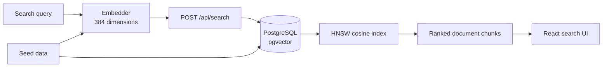

# Vector Search Studio

[](https://github.com/engida32/vector-search-studio/actions/workflows/ci.yml)


A semantic-search reference app: typo-tolerant retrieval over Supabase docs using a **pgvector**-backed PostgreSQL database, an HNSW index, and cosine distance, with a React/TypeScript UI, tests, and CI.

Built by Engida Lishan.

## What it demonstrates

- **pgvector** in production shapes: `vector(384)` column, HNSW cosine index, `<=>` distance queries
- **Typo-tolerant semantic search** with no keyword matching
- **React + TypeScript + Next.js (App Router)** from typed API to UI
- **Tests + CI**: Vitest unit tests for the embedder and seed data, plus typecheck, lint, and a no-Postgres smoke test in GitHub Actions

## Architecture



- `src/lib/embedder.ts`: deterministic 384-dimensional hashing embedder, L2-normalized. The tokenizer can be swapped for a real model without changing the schema or queries.
- `src/lib/seed.ts`: loads the sample documents and embeddings.
- `src/lib/db.ts`: PostgreSQL connection and pgvector setup.
- `src/app/api/search/route.ts`: query embedding, cosine-distance search, and JSON response.
- `src/app/page.tsx`: search interface.
- `scripts/seed-local.mjs`: local seed and search smoke test that runs without Postgres.
- `docker-compose.yml`: PostgreSQL with the pgvector extension.

The database creates the `documents` table and HNSW index on the first search. Seeding also happens on first use.

## Embeddings

The default embedder is deliberately self-contained: a signed random-projection hashing trick over normalized tokens, so the demo runs anywhere with no API keys. It produces an L2-normalized 384-dimension vector that fits the `vector(384)` column. Swap the tokenizer for any embedding model (OpenAI, sentence-transformers, and others) and the schema and queries stay the same.

## Run it

### 1. Postgres with pgvector (Docker)

```bash
docker compose up -d
cp .env.example .env
```

### 2. App

```bash
npm install
npm run dev
```

Open http://localhost:3000.

### No Postgres? Use the local fallback

```bash
npm run test
node --experimental-strip-types scripts/seed-local.mjs "get the best matching chunks for a question" 3
```

## Schema

The API creates this schema on first query.

```sql
CREATE EXTENSION IF NOT EXISTS vector;

CREATE TABLE documents (
  id        SERIAL PRIMARY KEY,
  title     TEXT NOT NULL,
  body      TEXT NOT NULL,
  embedding vector(384)
);

CREATE INDEX documents_embedding_hnsw
  ON documents USING hnsw (embedding vector_cosine_ops);
```

## CI

`.github/workflows/ci.yml` runs on every push and pull request: `typecheck`, `lint`, `vitest`, then the local search smoke test.

---

If you change the embedding dimension, update `DIM` in `src/lib/embedder.ts` and the `vector(384)` column in the schema SQL above.
